## Who this presentation is for {.smaller}

:::: {.columns}
::: {.column width="55%"}
Written for **neuro-oncologists, neurosurgeons, clinical neuroscientists and neuropsychologists**.

- Each section opens with a clinical question.
- Green boxes say why it matters clinically. Orange boxes say what the evidence does **not** show.
- The mathematics sits in optional **deep-dive** slides (press ↓ where shown).
- Dotted-underlined terms show a definition when you hover over them. There is also a glossary at the end.

**Navigation:** ← → between sections · ↓ for deep dives · `M` menu · `O` overview · `F` full screen · `S` speaker notes
:::
::: {.column width="45%"}
::: {.caveat}
**Research prototype, not for clinical use.** 
The results come from **one patient** (sub-PAT16, open OpenNeuro data). This is a working methods demonstration, not a validated predictive tool. It is not a medical device.
:::
::: {.evidence}
**Code, data and notebooks** (open): 
[github.com/arvidl/glioma-brain-digital-twin-public](https://github.com/arvidl/glioma-brain-digital-twin-public)
:::
:::
::::

::: notes
This deck accompanies the open repository. Everything shown comes from the capstone notebooks NB_C01 to NB_C09, and most figures are generated directly from them.
:::

## Nine clinical questions {.agenda}

1. What is a brain digital twin, and what data do we have?
2. What do the CANTAB tests measure, and how did the patient change?
3. What does the brain look like before and after surgery?
4. How is white matter organised, and how is structural connectivity disrupted?
5. How do spontaneous brain dynamics change after surgery?
6. How does the brain deform when the tumour is removed?
7. How do mechanics modulate neural dynamics?
8. Does predicted disruption match observed cognitive change?
9. What would it take to make this clinically useful?

::: notes
The structure follows the nine capstone notebooks. Each question maps to one notebook, NB_C01 to NB_C09.
:::

# 1 · The idea and the data

## Why glioma needs more than a tumour map

:::: {.columns}
::: {.column width="58%"}
- Gliomas are the most common primary malignant brain tumours. Diffuse gliomas (WHO grades 2–4) **infiltrate** tissue, which blurs the tumour–brain boundary.
- Surgery balances **extent of resection** against **functional preservation**.
- Postoperative cognition varies widely between patients. It depends on *distant* network effects and mass-effect release, not only on the lesion site.
- Mechanical compression from space-occupying tumours can itself harm neurons. Experimental work links chronic compression to neuronal apoptosis and reduced network activity [@zarodniuk2026].

::: {.clinic}
**Clinical question:** can we model, for an individual patient, *which functions are at risk* and *why*, before and after surgery?
:::
:::
::: {.column width="42%"}
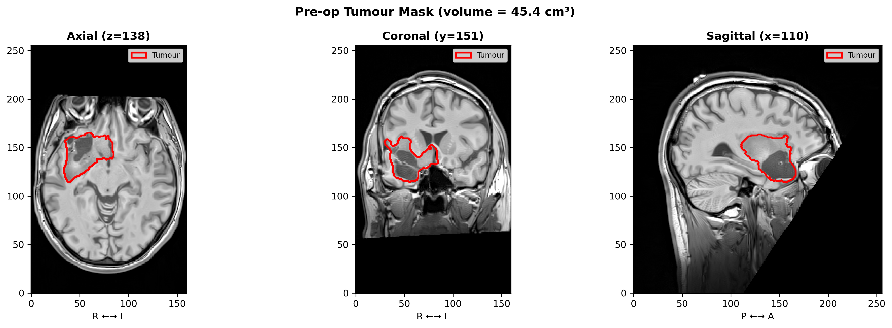{fig-alt="Pre-operative T1-weighted MRI with tumour outline"}

[sub-PAT16: pre-operative tumour outline (red), right fronto-temporal/insular, ≈45 cm³ on the segmentation mask.]{.cite}
:::
::::

## What is a brain digital twin?

A **patient-specific computational replica** that links what we can *measure* (MRI, cognition) with what we can *model* (tissue mechanics, network dynamics). It is used to explore *what happens if*.

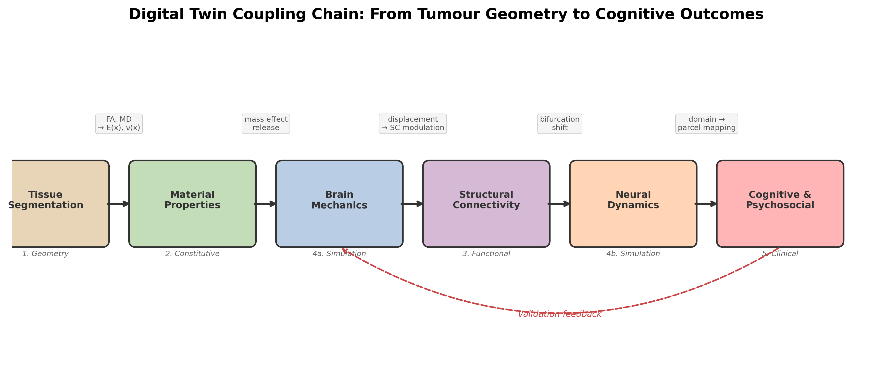{fig-alt="Coupling chain from tissue segmentation to cognitive outcome"}

::: {.columns}
::: {.column width="50%"}
::: {.clinic}
The chain ends in **cognition and psychosocial state**, the outcomes patients care about. That last link is what lets clinical data *test* the model.
:::
:::
::: {.column width="50%"}
::: {.caveat}
Today's twin is a **one-off, retrospective** reconstruction. It is not yet continuously updated with new data, and it is not used for prediction in practice.
:::
:::
:::

::: notes
The layers are geometry, tissue properties, structural connectivity, mechanics, dynamics and clinical outcome. The dashed feedback arrow is the validation link: observed cognitive change is compared with what the model predicts.
:::

## The patient and the data {.smaller}

:::: {.columns}
::: {.column width="40%"}
| | sub-PAT16 |
|---|---|
| Sex, age | Male, 39 |
| Diagnosis (as labelled in the dataset) | Anaplastic astrocytoma, WHO II–III |
| Location | Right fronto-temporal / insular |
| Tumour volume | 45–50 cm³ |
| Scanner | Siemens TrioTim 3 T |
| Sessions | Pre-op and post-op |

[Open data: Brain Tumor Connectomics, OpenNeuro [ds001226](https://openneuro.org/datasets/ds001226) / [ds002080](https://openneuro.org/datasets/ds002080), CC0 licence [@aerts2018; @aerts2022]. The diagnosis uses pre-2021 WHO terminology. Molecular markers (such as IDH status) are not available.]{.cite}
:::
::: {.column width="60%"}
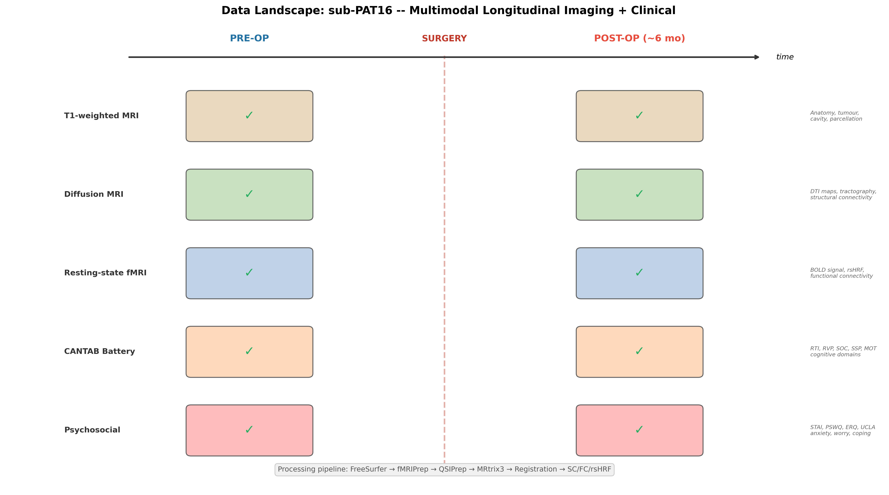{fig-alt="Timeline of imaging and clinical data before and after surgery"}
:::
::::

::: {.clinic}
The same five data types are available **before and after surgery**: T1w MRI, diffusion MRI, resting-state fMRI, CANTAB, and psychosocial questionnaires. That pairing is what makes the case useful for testing a twin.
:::

# 2 · Cognition and psychosocial state

## CANTAB: what was measured

| Test | Domain | Main circuits | Metric (better =) |
|---|---|---|---|
| **MOT** Motor screening | Basic motor response | precentral, paracentral | latency (lower) |
| **RTI** Reaction time | Processing speed, attention | precentral, superior frontal, basal ganglia–thalamocortical | RT (lower) |
| **RVP** Rapid visual processing | Sustained attention | dorsolateral PFC, inferior parietal | A′ (higher) |
| **SOC** Stockings of Cambridge | Planning, executive | dorsolateral PFC, pars opercularis | min-move solutions (higher) |
| **SSP** Spatial span | Visuospatial working memory | caudal middle frontal, superior parietal, precuneus | span (higher) |

::: {.caveat}
Raw scores only. There are **no normative z-scores**, and there is **one pre-op and one post-op session**. Practice effects and test–retest variability are not modelled.
:::

## How PAT16 changed (interactive)

<iframe class="interactive" data-src="assets/interactive/cantab.html" title="CANTAB change"></iframe>

::: notes
Faster reaction times (RTI: simple −14%, five-choice −10%) and a longer spatial span (6 to 7) improved. Motor latency was slightly slower (+3%). RVP and SOC were essentially unchanged. With only two sessions, gains of this size may partly be practice effects; motor slowing of 3% is within plausible test–retest noise.
:::

## Psychosocial context changed too (interactive)

:::: {.columns}
::: {.column width="62%"}
<iframe class="interactive" style="height:560px" data-src="assets/interactive/psychosocial.html" title="Psychosocial change"></iframe>
:::
::: {.column width="38%" .small}
- <abbr title="State-Trait Anxiety Inventory">STAI</abbr> anxiety **36 → 30** (better)
- <abbr title="Penn State Worry Questionnaire; >62 high worry">PSWQ</abbr> worry **54 → 61** (near threshold 62)
- <abbr title="Emotion Regulation Questionnaire">ERQ</abbr> reappraisal **24 → 14** (less adaptive coping)
- <abbr title="UCLA Loneliness Scale">UCLA</abbr> loneliness **40 → 50**
- Employment: **employed → sick leave**

::: {.clinic}
Worry, coping and isolation affect attention and executive performance independently of the lesion [@eysenck2007; @gross2015].
:::
:::
::::

# 3 · Anatomy before and after surgery

## Pre-op vs post-op structural MRI

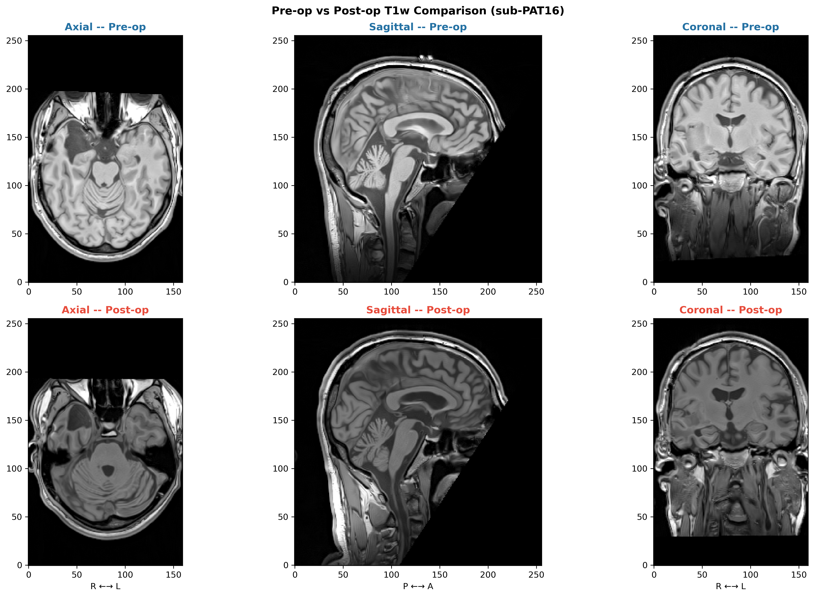{fig-alt="Pre- and post-operative T1-weighted MRI in three planes" height="560"}

::: {.small}
Resection cavity in the right temporal/insular region. Registering the post-op scan to the pre-op scan gives a measured **displacement field**, which is the "ground truth" the mechanics model is later compared against.
:::

## Segmentation and parcellation in practice

<video class="clip" data-src="assets/video/freeview_freesurfer_preop.mp4" poster="assets/video/freeview_freesurfer_preop_poster.jpg" controls muted loop playsinline></video>

[Pre-op FreeSurfer segmentation and Desikan–Killiany parcellation in Freeview. These 68 cortical regions are the nodes of the network model.]{.small}

# 4 · White matter and structural connectivity

## Tractography around the tumour

:::: {.columns}
::: {.column width="58%"}
<video class="clip" data-src="assets/video/tractography_preop.mp4" poster="assets/video/tractography_preop_poster.jpg" controls muted loop playsinline></video>
:::
::: {.column width="42%"}
- Diffusion MRI → fibre orientation → whole-brain **tractography**
- Streamlines are counted between 68 cortical regions, giving the **structural connectome** (<abbr title="Structural connectivity: weighted white-matter connections between brain regions">SC</abbr>)
- The tumour (yellow) sits next to temporal–insular and fronto-temporal pathways

::: {.caveat}
Tractography near tumour and oedema is biased. Pathways may be missed or invented.
:::
:::
::::

## Diffusion → tissue properties → connectome

:::: {.columns}
::: {.column width="50%"}
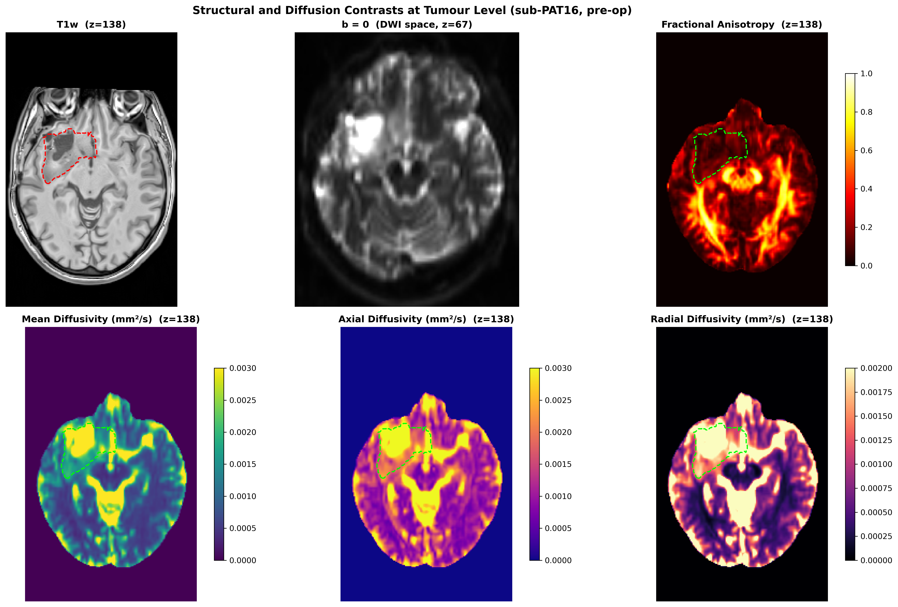{fig-alt="DTI scalar maps"}

[<abbr title="Fractional anisotropy">FA</abbr> and <abbr title="Mean diffusivity">MD</abbr> maps also inform the tissue stiffness used in the mechanics model.]{.small}
:::
::: {.column width="50%"}
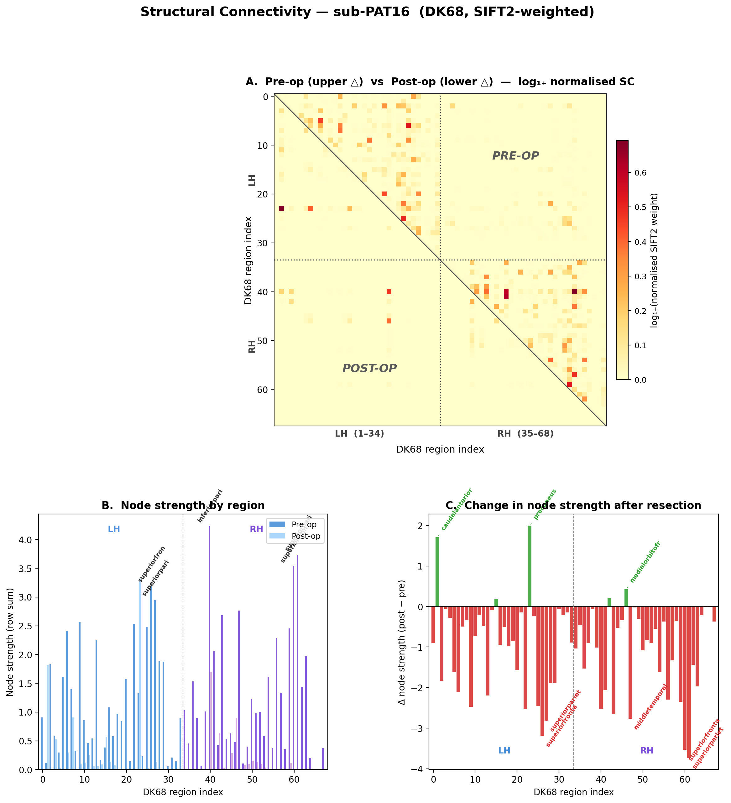{fig-alt="Structural connectivity matrix" height="560px"}

[68×68 structural connectivity, the network on which the dynamics model runs.]{.small}
:::
::::

# 5 · Spontaneous brain dynamics

## Resting-state fMRI: the brain's spontaneous activity

:::: {.columns}
::: {.column width="55%"}
<video class="clip" data-src="assets/video/fmri_preop.mp4" poster="assets/video/fmri_preop_poster.jpg" controls muted loop playsinline></video>
:::
::: {.column width="45%"}
- Each voxel has a **BOLD time course** (TR 2.4 s, 180 volumes, 3 mm voxels).
- Correlating regional time courses gives **functional connectivity** (<abbr title="Functional connectivity: correlation between regional BOLD time series">FC</abbr>).
- A single 55 µl fMRI voxel contains about 5.5 million neurons and 220 km of axons [@logothetis2008]. FC is a very coarse view of the network.

::: {.caveat}
BOLD is an indirect, haemodynamic signal. The tumour and the surgery can change neurovascular coupling itself.
:::
:::
::::

## Functional connectivity before surgery

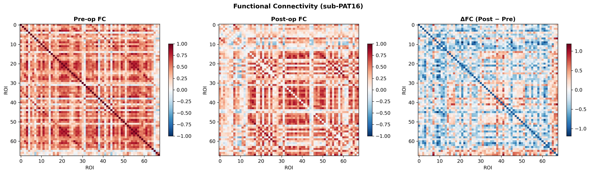{fig-alt="Functional connectivity matrices" height="600"}

[Empirical FC is the "target" a whole-brain model should reproduce.]{.small}

# 6 · Brain mechanics

## How does the brain deform when the tumour is removed?

:::: {.columns}
::: {.column width="40%"}
- A finite-element model (<abbr title="Open-source finite element library">FEniCSx</abbr>) of the patient's brain:
  - geometry from MRI segmentation
  - stiffness modulated voxel by voxel by diffusion MRI
  - loads: gravity plus **release of tumour mass effect**
- Output: a predicted displacement field, compared with the displacement **measured** by image registration.
:::
::: {.column width="60%"}
<iframe class="interactive" style="height:660px" data-src="assets/interactive/geometry_3d.html" title="3D patient geometry"></iframe>
[Interactive 3D patient geometry: drag to rotate, scroll to zoom, click legend entries to show or hide structures.]{.small}
:::
::::

## Model vs measurement: honest result

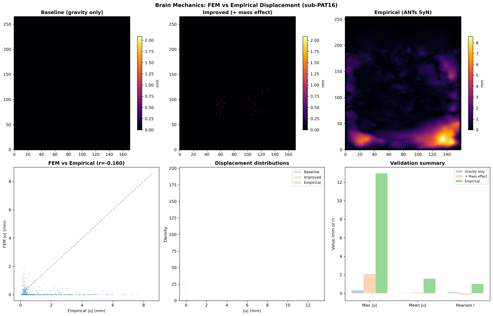{fig-alt="FEM versus empirical displacement" height="520"}

:::: {.columns}
::: {.column width="50%"}
::: {.evidence}
Adding mass-effect release moves the model closer to reality than gravity alone does.
:::
:::
::: {.column width="50%"}
::: {.caveat}
It still **underestimates** the measured shift (peak ≈ 2 mm vs ≈ 13 mm). Voxel-wise agreement is poor (r ≈ −0.16), so the mechanics layer is the weakest link today.
:::
:::
::::

## What the deformation looks like in this patient

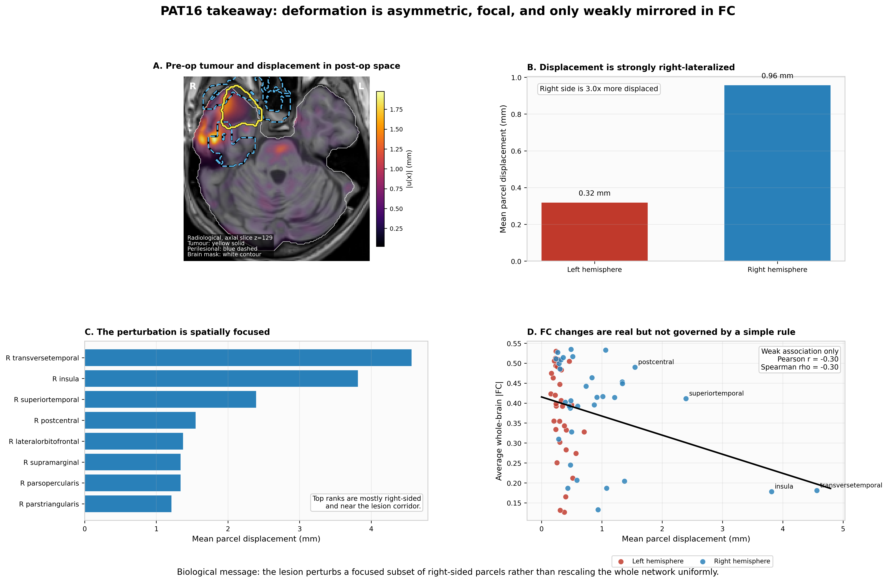{fig-alt="Deformation is right-lateralised and focal" height="620"}

[Measured deformation is right-lateralised (≈ 3× the left side) and concentrated in temporal–insular parcels. FC changes relate only weakly to it (r ≈ −0.30).]{.small}

## Deep dive: the mechanics model {.smaller}

Linear elasticity on the patient mesh, with heterogeneous parameters:

$$
-\nabla\cdot\sigma(u) = f, \qquad \sigma = 2\mu(x)\,\varepsilon(u) + \lambda(x)\,(\nabla\cdot u)\,I,\qquad \varepsilon = \tfrac12(\nabla u + \nabla u^\top)
$$

- $E(x)$ is mapped from <abbr title="Fractional anisotropy">FA</abbr> and $\nu(x)$ from <abbr title="Mean diffusivity">MD</abbr>. These mappings are heuristic.
- Mass-effect release is modelled as a pressure $p_0$ on the cavity boundary.
- The measured deformation has Jacobian determinant 0.55–1.27, i.e. up to 45 % compression and 27 % expansion. That is beyond the *small-strain* assumption, and calls for **hyperelastic or poroelastic** models.

::: {.caveat}
Material parameters are not fitted to this patient. Estimating them from pre/post imaging is an open **inverse problem**.
:::

# 7 · Mechanics and neural dynamics

## From deformation to network activity

:::: {.columns}
::: {.column width="45%"}
- **Structural coupling:** connections passing through strained tissue are weakened:
  $\;SC'_{ij} = SC_{ij}\,e^{-\alpha\,\bar{s}_{ij}}$
- **Excitability coupling:** displacement shifts each region's dynamics in a whole-brain <abbr title="Stuart–Landau (Hopf) oscillator model of regional activity">Hopf model</abbr>.
- The model then simulates functional connectivity, which is compared with the patient's FC.
:::
::: {.column width="55%"}
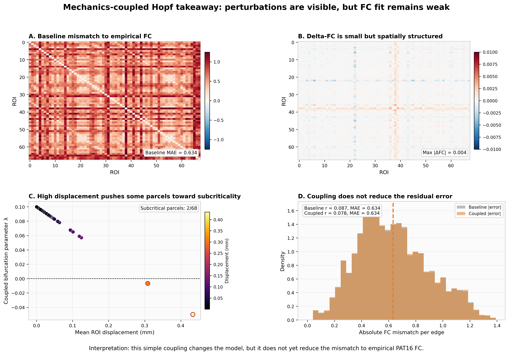{fig-alt="Coupled Hopf dynamics takeaway"}
:::
::::

::: {.caveat}
The coupling visibly changes the simulated network. But the fit to the patient's own FC is weak (r ≈ 0.08), and coupling does **not** reduce the error. The dynamics are not yet fitted to the patient.
:::

# 8 · Closing the loop

## Does predicted disruption match observed cognitive change?

- Map each CANTAB domain to its supporting cortical regions.
- **Predicted vulnerability** is the loss of structural connectivity in those regions after the mechanics coupling. It combines within-domain loss and loss of connections to the rest of the brain.
- **Observed change** is the direction-aligned CANTAB change (positive = better).

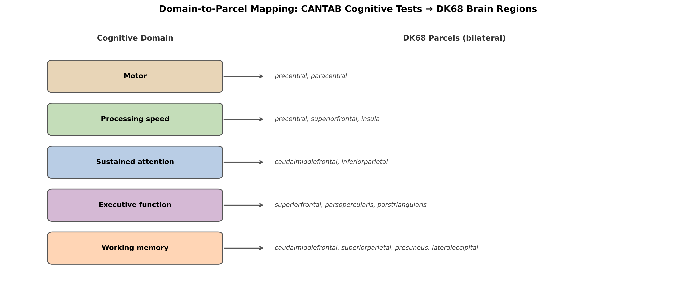{fig-alt="Mapping of cognitive domains to cortical parcels" height="420"}

::: {.caveat}
The domain-to-parcel mapping is broad and literature-based. It is not patient-specific, and it does not take hemisphere into account.
:::

## Four-zone view (interactive: move the slider)

<iframe class="interactive-tall" data-src="assets/interactive/four_zone.html" title="Four-zone closing-the-loop plot"></iframe>

::: notes
Move the slider to change the mechanics-to-connectivity coupling strength alpha. The ranking of domains by vulnerability is stable across the range, but the absolute values change. No domain shows a decline larger than 5 per cent, so no domain falls in the 'model-supported deficit' zone. Processing speed, attention/speed and working memory improved despite predicted vulnerability.
:::

## The same result as a static figure (NB_C08)

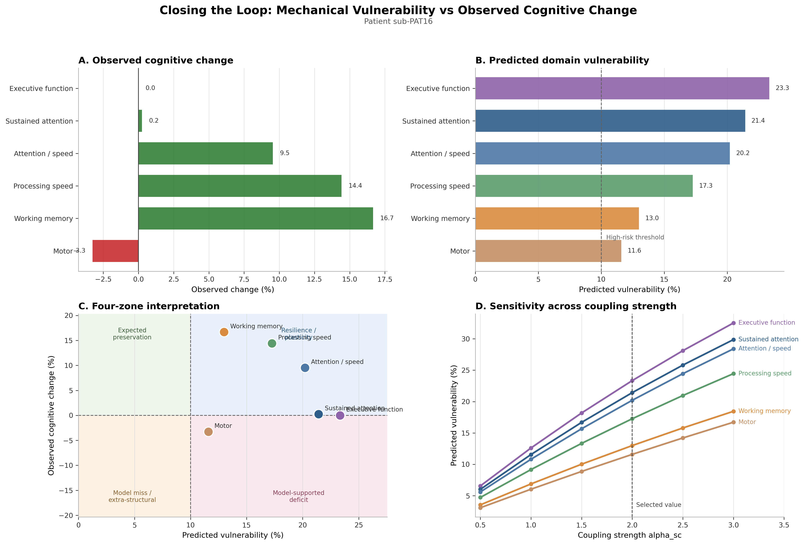{fig-alt="Four-panel closing-the-loop figure from notebook NB_C08" height="680px" fig-align="center"}

::: {.notes}
Static fallback for printing or offline use. Panels: predicted vulnerability, observed change, four-zone interpretation, sensitivity over the coupling strength alpha.
:::

## What the four-zone view tells us {.smaller}

| Domain | Predicted vulnerability | Observed change | Zone |
|---|---:|---:|---|
| Executive function (SOC) | 23.3 % | 0.0 % | Expected preservation |
| Sustained attention (RVP) | 21.4 % | +0.2 % | Expected preservation |
| Attention / speed (RTI 5-choice) | 20.2 % | +9.5 % | Resilience / plasticity |
| Processing speed (RTI simple) | 17.3 % | +14.4 % | Resilience / plasticity |
| Working memory (SSP) | 13.0 % | +16.7 % | Resilience / plasticity |
| Motor (MOT) | 11.6 % | −3.3 % | Expected preservation |

:::: {.columns}
::: {.column width="50%"}
::: {.evidence}
**What this shows:** the chain from mechanics to cognition runs end to end, and mismatches become *visible and discussable*.
:::
:::
::: {.column width="50%"}
::: {.caveat}
**What it does not show:** no observed decline exceeds 5 %, so no deficit is "confirmed". Two sessions cannot separate real recovery from **practice effects** or test–retest noise.
:::
:::
::::

## For neuropsychologists: how to read the mismatch

:::: {.columns}
::: {.column width="50%"}
### Why might predicted vulnerability *not* show up as decline?

- **Plasticity and compensation** in a slowly growing tumour
- **Practice effects** on repeated CANTAB testing (RT, span)
- **Relief from mass effect** and from diagnostic uncertainty (STAI ↓)
- Raw-score change with **no normative or reliable-change** reference
:::
::: {.column width="50%"}
### Why might decline appear *without* predicted vulnerability?

- **Psychosocial burden**: worry ↑, reappraisal ↓, loneliness ↑, sick leave
- **Fatigue, mood, medication, adjuvant treatment** (not modelled)
- Subcortical or white-matter effects outside the cortical parcels
:::
::::

::: {.clinic}
**Next step:** use *reliable-change indices* and normative z-scores, add psychosocial state as explicit model variables, and test in many patients.
:::

# 9 · From prototype to clinic

## What is shown, and what is not yet shown

:::: {.columns}
::: {.column width="50%"}
::: {.evidence}
**Supported by this work**

- A patient-specific twin *can* be assembled end-to-end from routine-type MRI plus cognitive testing.
- Mass-effect release matters for modelling postoperative brain shift.
- Domain-level structural vulnerability can be compared with cognition in a transparent way.
- Psychosocial state is part of the interpretation, not noise.
:::
:::
::: {.column width="50%"}
::: {.caveat}
**Not yet supported**

- Prediction for individual patients (n = 1, retrospective)
- Accurate mechanics: shift is underestimated, spatial agreement is poor
- Patient-fitted dynamics: FC fit is weak
- Uncertainty quantification across the chain
- Comparison against simpler baselines
:::
:::
::::

## Roadmap to clinical translation

| Stage | Goal | Key requirement |
|---|---|---|
| **Now** | Proof-of-concept (this work) | Transparent, open, reproducible pipeline |
| **1–2 years** | Multi-patient validation (full BTC cohort, n = 25) | Out-of-sample testing, uncertainty, baselines |
| **3–5 years** | Pre-surgical prediction | Does a *pre-op* twin predict the *post-op* state better than simpler models? |
| **Vision** | Decision support | In-silico comparison of resection or rehabilitation scenarios, with prospective evaluation |

::: {.clinic}
The decisive experiment is **prospective**: build the twin from pre-operative data only, predict the post-operative state, and compare against simple clinical models.
:::

## Mathematical challenges (deep dive) {.smaller}

- **Constitutive modelling:** move beyond small-strain linear elasticity (hyperelastic, poroelastic, growth).
- **Inverse problems:** estimate tissue and neural parameters from pre/post imaging.
- **Identifiability:** decide which parameters (`α`, excitability shift, bifurcation λ) the data can actually constrain.
- **Uncertainty propagation:** carry uncertainty from segmentation through tractography, mechanics and dynamics to cognition.
- **AI-assisted equation discovery:** learn interpretable reduced dynamics from longitudinal data.

## A glimpse of generative AI: "make the figure dance"

:::: {.columns}
::: {.column width="55%"}
<video class="clip" data-src="assets/video/gemini_veo_dance.mp4" poster="assets/video/gemini_veo_dance_poster.jpg" controls muted loop playsinline></video>
[AI-generated video (Google Gemini Veo, Nov 2025) from a single photo and a text prompt.]{.small}
:::
::: {.column width="45%"}
- A generative model *animates* a static scene, initialising a spatio-temporal model from one frame and a prompt.
- **Analogy for the twin:** from a static pre-op scan, can we learn plausible *dynamics* of the patient's brain?

::: {.caveat}
Generative video is plausible, not physical. Clinical twins need **mechanistic constraints and validation**, not just realism.
:::
:::
::::

## Take-home messages

1. A glioma brain digital twin **links mechanics, networks and cognition** in one patient-specific, open framework.
2. In this patient, mechanics and dynamics are **the weakest links**: brain shift is underestimated and FC fit is weak.
3. Predicted structural vulnerability **did not translate into measurable decline**. Resilience, practice effects and psychosocial context are all candidate explanations.
4. The value today is **transparency and testability**. The next step is **multi-patient, prospective** validation with neuropsychological rigour.

::: {.evidence}
Explore, reproduce and challenge it: [github.com/arvidl/glioma-brain-digital-twin-public](https://github.com/arvidl/glioma-brain-digital-twin-public)
:::

# Appendix

## Glossary {.smaller}

| Term | Meaning |
|---|---|
| **Digital twin** | Patient-specific computational model linked to that patient's measured data |
| **BIDS** | Brain Imaging Data Structure, a standard folder layout for neuroimaging data |
| **DK68** | Desikan–Killiany atlas: 68 cortical regions (34 per hemisphere) |
| **SC** | Structural connectivity: white-matter connection strength between regions (from tractography) |
| **FC** | Functional connectivity: correlation of resting-state BOLD signals between regions |
| **FA / MD** | Fractional anisotropy / mean diffusivity, diffusion MRI measures of tissue microstructure |
| **FEM** | Finite-element method, a numerical solution of tissue mechanics on a mesh |
| **Hopf model** | Whole-brain model in which each region is an oscillator near a bifurcation point |
| **α (alpha)** | Coupling strength: how strongly local strain weakens structural connections |
| **CANTAB** | Cambridge Neuropsychological Test Automated Battery |
| **Reliable change index** | Statistic testing whether a score change exceeds measurement error |

## Data, code and reproducibility {.smaller}

- **Repository:** [github.com/arvidl/glioma-brain-digital-twin-public](https://github.com/arvidl/glioma-brain-digital-twin-public), with the capstone notebooks `NB_C01`–`NB_C09` (runnable in Google Colab).
- **Data:** `python data/download_data.py --capstone`, from the OpenNeuro BTC datasets (CC0) plus project derivatives.
- **Pipeline:** FreeSurfer, fMRIPrep, QSIPrep, MRtrix3, ANTs, FEniCSx, The Virtual Brain-style Hopf model.
- **This presentation:** Quarto + reveal.js. The interactive figures are rebuilt from the notebooks by `presentation/build_figures.py`.

**Licences:** code MIT · text and figures CC-BY-4.0 · data CC0 (cite Aerts et al.).

## References {.smaller}

::: {#refs}
:::
